# 极限与连续
## 预备知识
### 集合
> 具有某种特定性质的事物的总体
1. 常用符号 
   | sign | description |
   | :---: | :---: |
   | $\phi$ | 空集 |
   | $a \in M$ | a属于M |
   | $a \notin M$ | a不属于M |
   | $M^*$ | M中排除0的集合 |
   | $M^+$ | M中排除0和负数的集合 |

***集合的全体不叫集合，叫类(class)***

2. 表示方法：
   列举法和描述法 
   | sign | name | represent |
   | :---: | :---: | :--- |
   | $N$ | 自然数集 | $\{0,1,\cdots,n,\cdots\}$|
   | $Z$ | 整数集 | $\{x \mid x \in N\ \text{or}\ -x \in N\}$ |
   | $Q$ | 有理数集 | $\{\frac{p}{q} \mid p \in Z,\ q \in N^2,\ p与q互质\}$ |
   | $R$ | 实数集 | $\{x \mid x\text{为有理数或无理数}\}$|
   | $(a,b)$ | 开区间 | $\{x \mid  a<x<b\}$ | 
   | $[a,b]$ | 闭区间 | $\{x \mid  a \leqslant x \leqslant b\}$ |

3. 集合的关系与运算 
   * 相等：$A=B \Leftrightarrow A \subset B \ \And \ A \subset B$
   * 差集：$A\setminus B=\{x|x \in A\ \And\ x \notin B\}$
   * 余集：$B^c_A = A\setminus B$
   * 直积(笛卡尔积)：$A \times B =\{(x,y)\mid x \in A,\ y \in B\}$ 
*$R \times R \overset{\text{记}}{=} R^2$为平面上全体点集*

### 邻域
> 设$x_0 \in R ,\  \delta > 0$,所有包含$x_0$的开区间都称为$x_0$的邻域

$x_0$的$\delta$邻域：$(x_0- \delta ,x_0 + \delta)$，记为：$U(x_0,\delta )$，点$x_0$称为邻域的中心，$\delta$称为邻域的半径.
$x_0$的去心$\delta$邻域：$(x_0-\delta,x_0)\cup (x_0,x_0 + \delta)$，记为：$\mathring{U}(x_0,\delta)$  ($\delta$均可省略)

### 数集的界
> 设非空数集$D \subset R$，若$\exist M$ *s.t.* 对 $\forall x \in D$,有$x \leqslant M$ 称$D$有上界$M$.

1. 数集$D$有界 $\Leftrightarrow \exist M>0$，*s.t.* 对 $\forall x\in D$，有 $|x|\leqslant M$
2. 数集$D$无界 $\Leftrightarrow $对 $\forall M>0$，总 $\exist x \in D$，*s.t.*$|x|>M$
3. 数集$D$有上确界$\beta$ $\Leftrightarrow \text{①} \exist \beta \in R,\ \forall x \in D$，有 $x \leqslant \beta \text{ ②}\forall \varepsilon >0,\exist x_\varepsilon \in D$*s.t.*$x_\varepsilon > \beta - \varepsilon$
   记为$\beta = supD$（$\beta$不一定可以在$D$中取到）
   同理，$\alpha$为$D$的下确界，记为$\alpha=infD$

### 映射
> 若存在一个法则$T$，使得$X$中的每一个元素$x$按法则$T$有唯一的元素$y$与之对应

1. $T$从$X$到$Y$的映射，记作$T:X\rightarrow Y$.
   元素$y$称为$x$在映射$T$下的**像**，记作$T(x)$.
   元素$x$称为$y$在映射$T$下的**原像**.
   集合$X$称为$T$的**定义域**，记作$D(T)$.
   $Y$的子集$T(x)=\{T(x)\mid x\in X\}$称为**值域**，常记为$R(T)$.
    
2. 若$T(X)=Y$，则称$T$为**满射**.
   若$\forall x_1,\ x_2\in X, x_1\neq x_2\text{, 有}T(x_1)\ne T(x_2)$，则称$T$为**单射**（也就是单调）.
   若$T:X\rightarrow Y$既是单射又是满射，则称$T:X\rightarrow Y$是**双射**，也称**一一对应**.
    
3. 若$f:D\rightarrow f(D)$为单射，则有$f^{-1}:f(D)\rightarrow D$，*s.t.*$\forall y\in f(D), f^{-1}(y)=x$其中$f(x)=y$，称$f^{-1}$为$f$的**逆映射**.
    
4. 设$f:D\rightarrow D_1,\ g:D_1\rightarrow D_2$，若 $f(D)\subset D_1$，即$f(x)$的值域包含在$g$的定义域中，或者$f$的值域与$g$的定义域交非空，即$f(D)\cup D_1\ne \phi$，则定义一新映射$g\circ f:D\rightarrow D_2$，称为**复合映射**
*$g\circ f(x) = g[f(x)]$*

### 函数
> 设非空集合$D\subseteq R$，称映射$f:D\rightarrow R$为定义在$D$上的函数

1. 图形：$C=\{(x,y)\mid y=f(x),\ x\in D\}\text{，或 }C=D\times f(D)$
    
2. 常用函数: 
   * 符号函数：
      $$
      y=\operatorname{sign} x=
      \begin{cases}
      1, & x>0\\
      0, & x=0\\
      -1, & x<0
      \end{cases}
      $$
   * 取整函数：
      $y=[x]$，当$n\leqslant x<n+1$时，$[x]=n$
   * 余切函数：
      $y=\cot x=\tan (\frac{\pi}{2}-x)=\frac{1}{\tan x}$（注意：$\cot x\neq \tan ^{-1}x$ 后者是$\tan x$的反函数）
      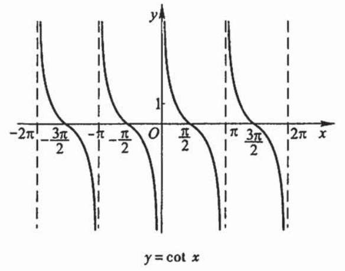
   * 正割函数：
      $y=\sec x=\frac{1}{\cos x}$
      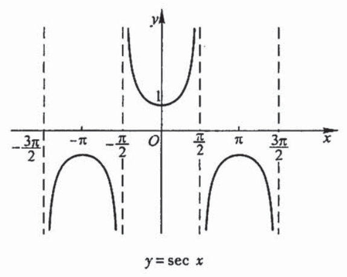
   * 余割函数：
      $y=\csc x=\frac{1}{\sin x}$
      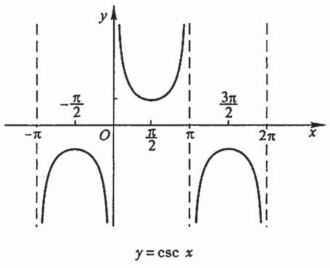
   * 反正弦函数： 
      对$y=\sin x$，若$x\in [-\frac{\pi}{2},\frac{\pi}{2}]$，则此时$[-\frac{\pi}{2},\frac{\pi}{2}]$$\xrightarrow[\text{1 - 1}]{}[-1,1]$，即$y=f(x)\text{在}[-\frac{\pi}{2},\frac{\pi}{2}]$的反函数存在，记$y=\arcsin x,\ x\in [-1,1],\ y\in [-\frac{\pi}{2},\frac{\pi}{2}]$. 
      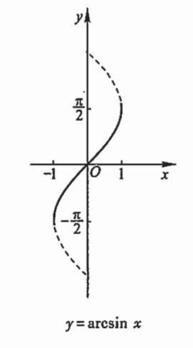
   * 反余弦函数： 
      同理：对$y=\cos x,\ x\in [0,\pi]$，有反函数$y=\arccos x,\ x\in [-1,1],\ y\in [0,\pi]$. 
      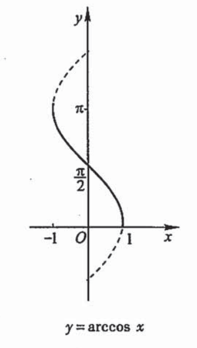
   * 反正切函数： 
      同理：对$y=\tan x,\ x\in [-\frac{\pi}{2},\frac{\pi}{2}]$，有反函数$y=\arctan x,\ x\in [-\infty,+\infty],\ y\in [-\frac{\pi}{2},\frac{\pi}{2}]$. 
      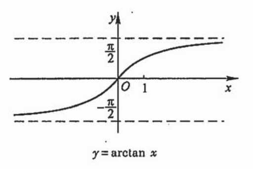
   * 反余切函数： 
      同理：对$y=\cot x,\ x\in [0,\pi]$，有反函数$y=\operatorname{arccot} x,\ x\in R,\ y\in [0,\pi]$. 
      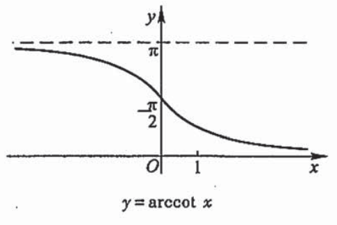
   * 双曲正弦： 
      $y=\frac{e^x-e^x}{2}\overset{\text{记}}{=} \sh x$，定义域是$R$，值域是$R$，是单调递增的奇函数.
   * 双曲余弦： 
      $y=\frac{e^x+e^x}{2}\overset{\text{记}}{=}\ch x$，定义域是$R$，值域是$[1,+\infty]$，是$R$上的偶函数.
      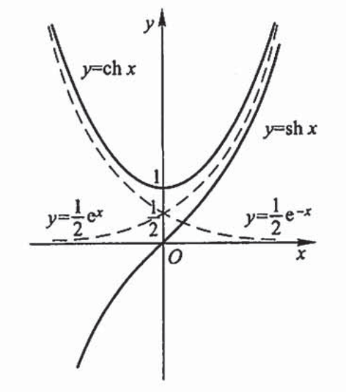
   * 双曲正切： 
      $y=\frac{\sh x}{\ch x}=\frac{e^x-e^{-x}}{e^x+e^{-x}}\overset{\text{记}}{=}\th x$，定义域是$R$，值域是$(-1,1)$，是$R$上的单调增加的奇函数.
      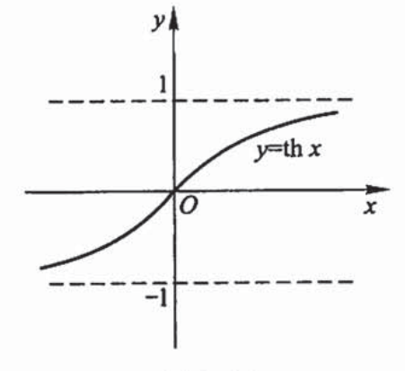
   *  反双曲正弦： 
      推导：由$y=\sh x=\frac{e^x-e^{-x}}{2}$，有$(e^x)^2-2y(e^x)-1=0$，故$e^x=y+\sqrt{y^2+1}$（负号舍去），从而$x=\ln(y+\sqrt{y^2+1})$ 
      $y=\operatorname{arsh}x=\ln(x+\sqrt{x^2+1})$，定义域是$R$，值域是$R$，是$R$上的单调增加的奇函数.
      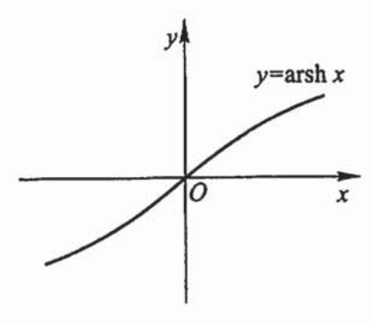
   * 反双曲余弦：$y=\operatorname{arch}x=\ln(x+\sqrt{x^2-1})$，定义域是$[1,+\infty)$，值域是$[0,+\infty)$，在定义域上是增函数.
      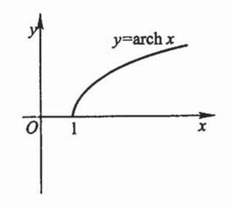
   * 反双曲正切：$y=\operatorname{arth}x=\frac{1}{2}\ln \frac{1+x}{1-x}$，定义域是$(-1,1)$，值域是$R$，在定义域上是单调增加的奇函数.
      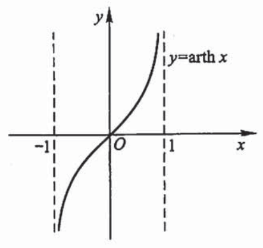
      

3. 特性：
   * 有界性
   * 奇偶性
   * 单调性： 
      $\forall x_1,\ x_2\in I,\ x_1<x_2\text{ , 若 }f(x_1)<f(x_2)$称$f(x)$在$I$上严格单调增加.
   * 周期性：**周期函数不一定存在最小正周期** 
      *e.g.* 常量函数：$f(x)=C$ 
      &emsp;&emsp;狄利克雷函数：$y=D(x)=\begin{cases}1, & x\in Q\\0, & x\in Q^c\end{cases}$
4. 反函数
   > 与映射的逆映射相对应

   $y=f(x),\ x\in D\text{ 记为 }y=f^{-1}(x),\ x\in f(x)$
   反函数和**直接函数**（原本的函数）**单调性相同**
   $y=f(x)$ 与 $y=f^{-1}(x)$ 关于 $y=x$ 对称.
    
5. 复合函数
   > 与映射的复合映射相对应

   $y=f(u),\ u\in D_1,\ u=g(x),\ x\in D\text{ 且 }g(D)\subset D_1\text{ 则 }y=f[g(x)]=f\circ g(x),\ x\in D$（$u$为中间变量）

   *e.g.* 对于 $y=\arcsin u,\ u=2\sqrt{1-x^2}$ 虽然值域和定义域并非包含关系，但其交集非空，仍可定义复合函数（但要注意修改定义域）
    
6. 初等函数
   > 由常数和基本初等函数经有限次的四则运算和复合步骤构成且可由一个算式表示的函数

   基本初等函数包括： 
   * 幂函数：$y=x^\mu$（$\mu$为常数）
   * 指数函数：$y=a^x$（$a>0,\ a\neq 1$为常数）
   * 对数函数：$y=\log_ax$（$a>0,\ a\neq 1$为常数）
   * 三角函数：$y=\sin x,\ y=\cos x,\ y=\tan x,\ y=\cot x,\ y=\sec x,\ y=\csc x$
   * 反三角函数：$y=\arcsin x,\ y=\arccos x,\ y=\arctan x,\ y=\operatorname{arccot} x$

## 数列极限
### 数列极限的概念
直观定义：设有数列$\{x_n\}$，当$n$无限增大时，$x_n$无限接近于某一个确定常数$a$，则称$a$为数列$\{x_n\}$的**极限**（或数列$\{x_n\}$**收敛**于$a$），记$\displaystyle\lim_{n \to \infty}x_n=a$ 或 $x_n\to a\ (n\to \infty)$.

数学定义：设有数列$\{x_n\}$，若$\forall \varepsilon>0,\ \exist N$ 当 $n>N$时，$|x_n-a|<\varepsilon$，则称$a$为数列$\{x_n\}$的极限.

>例1. 已知$x_n=\frac{n+(-1)^n}{n}$，证明$\{x_n\}$极限为$1$. 
> &emsp;&emsp;&emsp;&emsp;考虑$|x_n-1|=|\frac{n+(-1)^n}{n}-1|=|\frac{(-1)^n}{n}|=|\frac{1}{n}|\overset{\text{令}}{<}\varepsilon \Rightarrow n>\frac{1}{\varepsilon}$ 
> &emsp;&emsp;证明：对$\forall \varepsilon >0$，取$N=[\frac{1}{\varepsilon}]+1$，当$n>N$时，有$|x_n-1|<\varepsilon$，所以$\{x_n\}$极限为$1$.

> 例2.已知$x_n=\frac{(-1)^n}{(n+1)^2}$，证明$\displaystyle \lim_{n\to \infty}x_n=0$ 
> &emsp;&emsp;&emsp;&emsp;考虑令$|x_n-0|=\frac{1}{(n+1)^2}<\varepsilon$解出来太繁琐，尝试放缩. $|x_n-1|=\frac{1}{(n+1)^2}<\frac{1}{n+1}\overset{\text{令}}{<}\varepsilon \Rightarrow n>\frac{1}{\varepsilon}-1$ 
> &emsp;&emsp;证明：对$\forall \varepsilon >0$，取$N=[\frac{1}{\varepsilon}-1]+1$，当$n>N$时，有$|x_n-0|<\varepsilon$，所以$\displaystyle \lim_{n\to \infty}x_n=0$

### 数列极限的性质
1. 收敛数列的极限唯一.
2. 收敛数列一定有界，若数列无界则其一定发散.
   有界数列未必收敛.&emsp;&emsp;*e.g.*$\{x_n=(-1)^n\}$.
3. 收敛数列具有保号性.
      * 若$\displaystyle \lim_{n\to \infty}x_n=a$，且$a>0$($<0$)，则$\exist N\in N^+$，当$n>N$，有$x_n>\frac{a}{2}>0$.
      * 若$\{x_n\}$从某项起，$x_n\leqslant 0$($\geqslant 0$)，且$\displaystyle \lim_{n\to \infty}x_n=a$，则$a\leqslant 0$($\geqslant 0$)
4. （海涅归结原理）收敛数列的任一子数列收敛于同一极限.
### 数列极限的四则运算
若$\displaystyle \lim_{n\to \infty}x_n=A$，$\displaystyle \lim_{n\to \infty}y_n=B$，则有
1. $\displaystyle \lim_{n\to \infty}(x_n\pm y_n)=A\pm B=\displaystyle \lim_{n\to \infty}x_n\pm \displaystyle \lim_{n\to \infty}y_n$
2. $\displaystyle \lim_{n\to \infty}x_ny_n=AB=\displaystyle \lim_{n\to \infty}x_n\cdot \displaystyle \lim_{n\to \infty}y_n$
3. 当$y_n\ne 0$且$B\ne 0$，$\displaystyle \lim_{n\to \infty}\frac{x_n}{y_n}=\frac{A}{B}=\frac{\displaystyle \lim_{n\to \infty}x_n}{\displaystyle \lim_{n\to \infty}y_n}$
### 数列极限存在的判定定理
1. 夹逼准则：
      $$
      \begin{rcases}
      y_n\leqslant x_n\leqslant z_n(n=1,2,\cdots)\\
      \displaystyle \lim_{n\to \infty}y_n=\displaystyle \lim_{n\to \infty}z_n=a
      \end{rcases}\Rightarrow \displaystyle \lim_{n\to \infty}x_n=a
      $$
2. 单调有界数列必有极限.
3. 柯西收敛准则：
      数列$\{x_n\}$收敛$\Leftrightarrow \forall \varepsilon >0,\ \exist N_0\in Z^+,\ m,n>N_0,\ |x_m-x_n|<\varepsilon $
      数列$\{x_n\}$是柯西数列，则$\forall \varepsilon >0,\ \exist N_0\in Z^+,\ n>N_0,\ |x_{n+p}-x_n|<\varepsilon$对所有$p\in Z^+$成立.

重要极限：$\displaystyle \lim_{n\to \infty}\sqrt[n]{n}=1$，$\displaystyle \lim_{n\to \infty}\sqrt[n]{a}=1$，$\displaystyle \lim_{n\to \infty}(1+\frac{1}{n})^n=\mathrm{e}$

## 函数极限
### 自变量趋于无穷大时函数的极限
1. $\displaystyle \lim_{x\to \infty}f(x)=A \Leftrightarrow \forall \varepsilon >0,\ \exist X>0$，当 $|x|>X$ 时 $|f(x)-A|<\varepsilon$
2. $\displaystyle \lim_{x\to +\infty}f(x)=A \Leftrightarrow \forall \varepsilon >0,\ \exist X>0$，当 $x>X$ 时 $|f(x)-A|<\varepsilon$
3. $\displaystyle \lim_{x\to -\infty}f(x)=A \Leftrightarrow \forall \varepsilon >0,\ \exist X>0$，当 $x<-X$ 时 $|f(x)-A|<\varepsilon$

$\displaystyle \lim_{x\to \infty}f(x)=A\Leftrightarrow \displaystyle \lim_{x\to -\infty}f(x)=A$ 且 $\displaystyle \lim_{x\to +\infty}f(x)=A$
### 自变量趋于有限值时函数的极限
直观定义：设 $y=f(x)$ 在 $x_0$ 的某一去心邻域内有定义，如果当  $x$ 无限逼近到某一 $x_0$ 时，相应的 $f(x)$ 也无限逼近某个确定常数 $A$ ，称为 $f(x)$ 当$x\to x_0$ 时的极限，记为 $\displaystyle \lim_{x\to x_0}f(x)=A$.

数学定义：对 $\forall \varepsilon >0,\ \exist \delta>0$ 当 $0<|x-x_0|<\delta$ 时，有 $|f(x)-A|<\varepsilon$ 成立，此时称$\displaystyle \lim_{x\to x_0}=A$

$\displaystyle \lim_{x\to x_0}=A\Leftrightarrow \forall \varepsilon >0,\ \exist \delta>0$，当 $x\in \mathring{U}(x_0,\delta)$ 时，有 $|f(x)-A|<\varepsilon$.

> 例.用定义证明 $\displaystyle \lim_{x\to 1}\frac{x^2-1}{2x^2-x-1}=\frac{2}{3}$
> &emsp;&emsp;&emsp;&emsp;考虑：$|f(x)-\frac{2}{3}|=|\frac{(x-1)(x+1)}{(x-1)(2x+1)}-\frac{2}{3}|=|\frac{1-x}{3(2x+1)}|\overset{\text{令}}{<}\varepsilon$（太麻烦）
> &emsp;&emsp;方法：**先限制后放大**
> &emsp;&emsp;&emsp;&emsp;令 $|x-1|<\frac{1}{2}\Rightarrow \frac{1}{2}<x<\frac{3}{2}$（且$x\ne 1$），在此限制条件下：$\frac{|x-1|}{3(2x+1)}<\frac{|x-1|}{6}\overset{令}{<}\varepsilon \Rightarrow|x-1|<6\varepsilon $
> &emsp;&emsp;证明：$\forall \varepsilon >0,\ \exist \delta=min\{6\varepsilon,\ \frac{1}{2}\}$，当 $|x-1|<\delta$ 时，有 $|f(x)-\frac{2}{3}|<\varepsilon$ 成立

### 单侧极限
> 若 $\forall \varepsilon >0,\ \exist \delta >0$，*s.t.* 当        $x_0<x<x_0+\delta$ 时有 $|f(x)-A|<\varepsilon$ ，则称数$A$为函数$f$当$x$趋于$x_0$时的**右极限**，记作 **$\displaystyle \lim_{x\to x_0^+}f(x)=A$** ，或 $\displaystyle \lim_{x\to x_0^{+0}}f(x)=A$，或 $f(x)\to A(x\to x_0^+)$ 或 $f(x_0+0)=A$

$\displaystyle \lim_{x\to x_0}f(x)=A\Leftrightarrow \displaystyle \lim_{x\to x_0^+}f(x)=\displaystyle \lim_{x\to x_0^-}f(x)=A$
## 函数极限的性质与运算法则
### 性质
* 极限唯一性：如果$\displaystyle \lim_{x\to x_0}f(x)$极限存在，则极限唯一.
* 函数局部有界性：如果$\displaystyle \lim_{x\to x_0}f(x)$极限存在，则$f(x)$在$x_0$的某一去心邻域内有界.
* 函数局部保号性:
  * $\displaystyle \lim_{x\to x_0}f(x)=A>0(A<0)$，则存在$x_0$的某一去心邻域*s.t.* 当 $x\in \mathring{U}(x_0,\delta)$ 时，$f(x)>0(f(x)<0)$
  * $f(x)\geqslant 0(f(x)\leqslant 0)$，且$\displaystyle \lim_{x\to x_0}f(x)=A\Rightarrow A\geqslant 0(A\leqslant 0)$
### 运算法则
* 设$\lim f(x)=A,\ \lim g(x)=B$
  * $\lim [f(x)\pm g(x)]=\lim f(x)\pm \lim g(x)=A\pm B$
    * $f(x)\geqslant g(x)\Rightarrow A\geqslant B$
   * $\lim [f(x)g(x)]=\lim f(x)\cdot \lim g(x)=AB$
   * 若 $\lim g(x)=B\ne 0$，则 $\lim \frac{f(x)}{g(x)}=\frac{\lim f(x)}{\lim g(x)}=\frac{A}{B}$
* $\lim [c\cdot f(x)]=c\cdot \lim f(x)$
* $\lim [f(x)]^n=[\lim f(x)]^n$
* $f(x)=a_0x^n+a_1x^{n-1}+\cdots a_{n-1}x+a_n$，则$\displaystyle \lim_{x\to x_0}f(x)=a_0x_0^n+a_1x_0^{n-1}+\cdots a_{n-1}x_0+a_n=f(x_0)$
* $Q(x_0)\ne 0$，则$\displaystyle \lim_{x\to x_0}\frac{P(x)}{Q(x)}=\frac{P(x_0)}{Q(x_0)}$
* 设：
   1. $\displaystyle \lim_{t\to t_0}\varphi(t)=x_0$
   2. 在$t_0$的某一去心邻域内$\varphi(t)\ne x_0$
   3. $\displaystyle \lim_{x\to x_0}f(x)=A$

   则 $\displaystyle \lim_{t\to t_0}f[\varphi(t)]\xlongequal{x=\varphi(t)}\displaystyle \lim_{x\to x_0}f(x)=A$
## 函数极限存在条件
### 归结原理
> $\displaystyle \lim_{x\to x_0}f(x)=A\Leftrightarrow \forall \{x_n\}:x_n\ne x_0,\ f(x)$ 有定义 $x_n\to x_0(n\to \infty)$，有 $\displaystyle \lim_{n\to \infty}f(x_n)=A$

用于判断极限不存在：
1. 找$\{x_n\}:x_n\ne x_0$ 且 $\displaystyle \lim_{n\to \infty}x_n=x_0$ *s.t.* $\displaystyle \lim_{n\to \infty}f(x_n)$ 不存在.
2. 找两个以$x_0$为极限的数列$\{x_n'\},\{x_n''\}$ *s.t.* $\displaystyle \lim_{n\to \infty}f(x_n')$ 和 $\displaystyle \lim_{n\to \infty}f(x_n'')$ 均存在但不等.
> 例.证明 $\displaystyle \lim_{x\to 0}\sin \frac{1}{x}$ 不存在.
> &emsp;&emsp;证：取两趋于$0$的数列：
> &emsp;&emsp;&emsp;&emsp;$x_n=\frac{1}{2n\pi},\ x_n'=\frac{1}{2n\pi +\frac{\pi}{2}}(n=1,2,\cdots)$
> &emsp;&emsp;&emsp;&emsp;有 $\displaystyle \lim_{n\to 0}\sin \frac{1}{x_n}=\displaystyle \lim_{n\to 0}\sin 2n\pi=0$，$\displaystyle \lim_{n\to 0}\sin \frac{1}{x_n'}=\displaystyle \lim_{n\to 0}\sin (2n\pi+\frac{\pi}{2})=1$
> &emsp;&emsp;&emsp;&emsp;则 $\displaystyle \lim_{n\to 0}\sin \frac{1}{x_n}\ne \displaystyle \lim_{n\to 0}\sin \frac{1}{x_n}$，由归结原理，$\displaystyle \lim_{x\to 0}\sin \frac{1}{x}$ 不存在.
### 夹逼准则
当 $x\in \mathring{U}(x_0,\delta)$ 时，$g(x)\leqslant f(x)\leqslant h(x)$ 且 $\displaystyle \lim_{x\to x_0}g(x)=\displaystyle \lim_{x\to x_0}h(x)=A\Rightarrow \displaystyle \lim_{x\to x_0}f(x)=A$
### 重要极限
* $\displaystyle \lim_{x\to 0}\frac{\sin x}{x}=1$
   *Remark:* $\displaystyle \lim_{\varphi(x)\to 0}\frac{\sin \varphi(x)}{\varphi(x)}=1$
* $\displaystyle \lim_{x\to \infty}(1+\frac{1}{x})^x=\text{e}$ *also.* $\displaystyle \lim_{x\to \infty}(1+x)^{\frac{1}{x}}=\text{e}$
   *Remark:* $\displaystyle \lim_{\varphi(x)\to \infty}(1+\frac{1}{\varphi(x)})^{\varphi(x)}=\text{e}$
## 无穷小与无穷大
### 无穷小
> 若 $\underset{(x\to \infty)}{x\to x_0}$ 时，函数 $f(x)\to 0$，则称函数 $f(x)$ 为 $\underset{x\to \infty}{x\to x_0}$ 时的**无穷小量**，简称**无穷小**.
> &emsp;&emsp;*e.g.* $\displaystyle \lim_{x\to 1}(x-1)=0$，则函数 $f(x)=x-1$ 为当$x\to 1$时的无穷小.

任一不为零的常数都不是无穷小.即$\displaystyle \lim_{x\to x_0}C=0\Rightarrow C=0$

* $\displaystyle \lim_{x\to x_0}f(x)=A\Leftrightarrow f(x)=A+\alpha$，其中$\alpha$为$x\to x_0$时的无穷小
* 同一自变量的变化过程下的有限个无穷小的和仍为无穷小.
   *e.g.* $\displaystyle \lim_{x\to x_0}\alpha=0,\displaystyle \lim_{x\to x_0}\beta=0$，则 $\displaystyle \lim_{x\to x_0}\alpha+\beta=0$
* 有界函数与无穷小乘积为无穷小
* 有限个无穷小乘积为无穷小
* 常数乘无穷小为无穷小
### 无穷大
> 若 $\forall M>0,\ \underset{(X>0)}{\exist \delta >0}$，当$\underset{(|x|>X)}{0<|x-x_0|<\delta}$ 时，有 $|f(x)|>M$ 称函数$f(x)$是 $\underset{(x\to \infty)}{x\to x_0}$ 时的**无穷大量**，简称**无穷大**.

若 $f(x)>M\Rightarrow \displaystyle \lim_{\underset{(x\to \infty)}{x\to x_0}}f(x)=+\infty$
若 $f(x)<-M\Rightarrow \displaystyle \lim_{\underset{(x\to \infty)}{x\to x_0}}f(x)=-\infty$

*remark:* 无穷大不是数，所以 $\lim f(x)=\infty$ 意为$f(x)$的极限不存在.
&emsp;&emsp; &emsp; 函数为无穷大，必定无界，反之不真.

> 求证：$\displaystyle \lim_{x\to 1}\frac{1}{x-1}=\infty $
> &emsp;&emsp;证：$\forall M>0$，*s.t.* $|\frac{1}{x-1}|>M$，即 $|x-1|<\frac{1}{M}$
> &emsp;&emsp;&emsp;&emsp;只要取 $\delta =\frac{1}{M}$，当 $0<|x-1|<\delta $，有 $\frac{1}{|x-1|}>M$，则 $\displaystyle \lim_{x\to 1}\frac{1}{x-1}=\infty $

*Remark：* 若 $\displaystyle \lim_{x\to x_0}f(x)=\infty $，则 $l:x=x_0$ 为 $y=f(x)$ 的**铅垂渐近线**.

在自变量的同一变化中，若$f(x)$无穷大，则$\frac{1}{f(x)}$无穷小;若$f(x)$无穷小且$f(x)\ne 0$，则$\frac{1}{f(x)}$无穷大.
### 无穷小的比较
1. *def.* 无穷小的阶
   设$\alpha,\beta$为自变量同一变化中的无穷小，若：
   * $\displaystyle \lim \frac{\beta}{\alpha}=0$，称$\beta$是$\alpha$的**高阶无穷小**，记$\beta=o(\alpha)$ 
   $\\[2pt]$
   * $\displaystyle \lim \frac{\beta}{\alpha}=\infty$，称$\beta$是$\alpha$的**低阶的无穷小** 
   $\\[2pt]$
   * $\displaystyle \lim \frac{\beta}{\alpha}=C\ne 0$，称$\beta$是$\alpha$的**同阶无穷小**，记$\beta=O(\alpha)$
   $\\[2pt]$
   * $\displaystyle \lim \frac{\beta}{\alpha ^k}=C\ne 0$，称$\beta$是$\alpha$的 **$k$阶无穷小**
   $\\[2pt]$
   * $\displaystyle \lim \frac{\beta}{\alpha}=1$，称$\beta$与$\alpha$是**等阶无穷小**，记$\beta \sim \alpha$
2. *thm.*：$\alpha \sim \beta \Leftrightarrow \beta = \alpha + o(\alpha)$
3. *thm.*：设 $\alpha \sim \alpha',\beta \sim \beta'$，且$\lim \frac{\beta'}{\beta}$存在，则 $\lim \frac{\beta}{\alpha}=\lim \frac{\beta'}{\alpha'}$
   加减不可用无穷小替换，乘除可以 
   *e.g.* $\displaystyle \lim_{x\to 0}\frac{\tan 2x}{\sin 5x}=\displaystyle \lim_{x\to 0}\frac{2x}{5x}=\frac{2}{5}$ 
   *e.g.* $\displaystyle \lim_{x\to 0}\frac{\tan 2x-\sin x}{\sqrt{1+x}-1}\ne \displaystyle \lim_{x\to 0}\frac{2x-x}{\frac{1}{2}x}$ 
   &emsp;&emsp;正解：$=\displaystyle \lim_{x\to 0}\frac{x+o(2x)-o(x)}{\frac{1}{2}x}=\displaystyle \lim_{x\to 0}(\frac{x}{\frac{1}{2}x}+4\frac{o(2x)}{2x}-2\frac{o(x)}{x})=2+0-0=2$
4. 常见等价无穷小（当$x\to 0$）：
   $\sin x\sim x,$&emsp;&emsp;$\tan x\sim x,$&emsp;&emsp;$\arcsin x\sim x,$&emsp;&emsp;$\arctan x\sim x,$
   $1-\cos x\sim \frac{1}{2}x^2,$&emsp;&emsp;$\ln(1+x)\sim x,$&emsp;&emsp;$e^x-1\sim x,$&emsp;&emsp;$(1+x)^\alpha-1\sim \alpha x,$
   *Remark：* 均可推广到$\varphi(x)$.
## 函数的连续性与间断点
###　函数的连续性
函数**连续**的三种定义： 
   1. 若满足：
      1. $y=f(x)$在$x_0$点及近旁有定义.
      2. $\displaystyle \lim_{x\to x_0}f(x)$存在.
      3. $\displaystyle \lim_{x\to x_0}f(x)=f(x_0)$.
      则称$f(x)$在$x_0$处连续.
   2. $\forall \varepsilon >0,\ \exist \delta >0$，当 $|x-x_0|<\delta$ 时，$|f(x)-f(x_0)|<\varepsilon$，则称$f(x)$在$x_0$点连续.
   3. 设$y=f(x)$在$x_0$的某一邻域$U(x_0)$有定义，$\Delta x=x-x_0, \Delta x$为函数在$x_0$附近的自变量增量，$\Delta x=\begin{cases}
      <0, & x< x_0\\
      =0, & x= x_0\\>0, & x> x_0
   \end{cases}$，$\Delta y|_{x_0}$称为$f(x)$在$x_0$处的函数增量，对 $\Delta y|_{x_0}=f(x)-f(x_0)=f(x_0+\Delta x)-f(x_0)$，若 $\displaystyle \lim_{\Delta x\to 0}\Delta y=0$，则称$f(x)$在$x_0$点连续.

若$f(x)$在某区间上每一点都连续，则称它在该区间上连续或为该区间上的**连续函数**，记作 **$C[a,b]$**.

函数$f(x)$在点$x_0$连续$\Leftrightarrow \displaystyle \lim_{x\to x_0}f(x)=f(x_0)\Leftrightarrow \displaystyle \lim_{\Delta x\to 0}f(x_0+\Delta x)=f(x_0)\Leftrightarrow \displaystyle \lim_{\Delta x\to}\Delta y=0\Leftrightarrow f(x_0^-)=f(x_0)=f(x_0^+)\Leftrightarrow \forall \varepsilon >0,\ \exist \delta >0$，当$|x-x_0|=|\Delta x|<\delta$，有$|f(x)-f(x_0)|=|\Delta y|<\varepsilon$

$f(x)$在$[a,b]$上连续$\Leftrightarrow \forall x\in (a,b),\ f(x)$在$x$点连续，且$f(x)$在左端点$a$右连续，在右端点$b$左连续.
### 间断点及其分类
> 设$f(x)$在$x_0$的某去心邻域内有定义，若满足*之一*：
>   1. $f(x)$在$x_0$无定义.
>   2. $f(x)$在$x_0$有定义，但$\displaystyle \lim_{x\to x_0}f(x)$不存在.
>   3. $f(x)$在$x_0$有定义，且$\displaystyle \lim_{x\to x_0}f(x)$存在，但$\displaystyle \lim_{x\to x_0}f(x)\ne f(x_0)$.
> 这样的点叫间断点.

*Classification:*
* **第一类间断点**：$f(x_0^-),f(x_0^+)$均存在
  * $f(x_0^-)=f(x_0^+)\Rightarrow $ **可去间断点**
  * $f(x_0^-)\ne f(x_0^+)\Rightarrow $ **跳跃间断点**
* **第二类间断点**：$f(x_0^-),f(x_0^+)$至少一个不存在
  * 其中有一个为 $\infty \Rightarrow $ **无穷间断点**
  * 其中有一个为振荡 $\Rightarrow $ **振荡间断点**
### 连续函数性质
*Thm.:*
1. 在某点连续的有限个函数经有限次和，差，积，商(分母不为零)运算，结果仍是一个在该点连续的函数.
2. 连续单调递增(递减)函数的反函数也连续单调递增(递减).
3. 连续函数的复合函数是连续的.
4. 若$f$在点$x_0$连续，则$f$在点$x_0$的某邻域$U(x_0)$有界.
5. 若$f$在点$x_0$连续，且$f(x_0)>0(<0)$，则$\forall r \in (0,f(x_0))(r \in (f(x_0),0)),\ \exist u(x_0)$，*s.t.* $\forall x\in U(x_0)$，有$f(x)>r>0(f(x)<r<0)$.
6. 一切初等函数在其定义域内都是连续的.

$$\varphi(x)^{\psi(x)}=e^{\ln \varphi(x)^{\psi(x)}}=e^{\psi(x)\ln \varphi(x)}$$
> *e.g.* 求 $\displaystyle \lim_{x\to 0}(1+2x)^{\frac{3}{\sin x}}$.
> 解：原式$=\displaystyle \lim_{x\to 0}e^{\frac{3}{\sin x}\ln(1+2x)}=\displaystyle \lim_{x\to 0}e^{\frac{3}{x}\cdot 2x}=e^6$
## 闭区间上连续函数的性质
*Thm:*
1. **最值定理**：在闭区间上连续的函数在该区间上一定有最大值和最小值.
   即：设 $f(x)\in C[a,b]$，则 $\exist \xi_1,\xi_2\in [a,b]$，*s.t.* $f(\xi_1)=\displaystyle \min_{a\leqslant x\leqslant b}f(x)$，$f(\xi_2)=\displaystyle \max_{a\leqslant x\leqslant b}f(x)$
   * 在闭区间上连续的函数在该区间上有界.
2. **零点定理**：$f(x)\in C[a,b]$，且 $f(a)f(b)<0\Rightarrow $至少有一点$\xi\in(a,b)$，*s.t.* $f(\xi)=0$
3. **介值定理**：设 $f(x)\in C[a,b]$，且$f(a)=A,f(b)=B,A\ne B$，则对$A$与$B$之间的任一数$C$，至少有一点$\xi\in(a,b)$，*s.t.* $f(\xi)=C$.
   * 在闭区间上的连续函数必取得介于最小值与最大值之间的任何值.